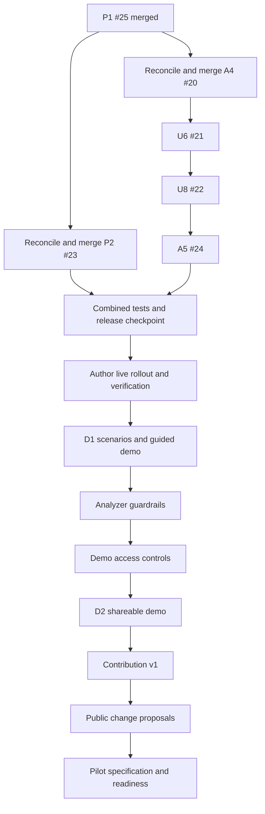

# ISR MVP: overall and detailed development plan

Prepared: **2026-11-12**, Europe/Kyiv. Baseline: main `6d252c2` (P1 PR #25 merged), with the A5 emulator preview at `0ff325b`.

**Status: APPROVED 2026-11-12 (author: "Approved.").** Existing approved task specs and decisions remain authoritative. This document organizes their remaining work and proposes the order for later stages; it does not authorize merges, live writes, deploys, new formulas or new features. Model recommendations are advisory. Estimates are planning ranges, not delivery commitments.

## 1. Direction and finish lines

The next useful result is a **credible guided demonstration** of issue-specific participation on the synthetic population. First finish the work already implemented, bring live code and data into alignment, and make the full issue cycle reproducible. Then make the demo suitable for independent visitors. Contribution and pilot features follow under their own specifications.

| Milestone | Result | Completion criterion |
|---|---|---|
| M0: integrated release | The tested branches are together on main. | P2, A4, U6, U8 and A5 merged after reconciliation, full combined tests/CI pass, release commit recorded. |
| M1: working live foundation | Live has the repaired population, property, current AI/embeddings and maps. | Author rollout complete; profile, location, vector, scoring and deployed-file checks pass; no mixed embedding models remain in active computations. |
| M2: D1 guided demo | The author can demonstrate the complete cycle in 10-15 minutes. | Approved scenarios, reproducibility checker, repeatable seed, named snapshot, presenter script and AI-unavailable fallback all accepted. |
| M3: Analyzer guardrails | Ambiguous or inconsistent input is handled according to an approved protocol. | Clarification, consistency/range rules and server validation have representative tests and match the shown result. |
| M4: D2 shareable demo | Invited testers can use the demo independently. | M2/M3 plus authentication, authorization, protected writes, AI usage controls and an end-to-end access test. |
| M5: complete participation model | Contribution and member-led issue changes work. | Contribution v1 and public change proposals each have approved specs, reproducible data and end-to-end acceptance. |
| M6: pilot readiness | Prepare a separately scoped pilot with real people. | Resolve soft-D/inclusion/cap policy, gISR/AAuth, privacy and operational requirements; explicitly approve a pilot plan. |

This follows [PD-6](decisions/PD-6-mvp-status-and-paper.md): a design proposal and partial synthetic prototype can support the paper. Completing every pilot feature is not a prerequisite for that paper or the guided demo.

## 2. Current position: finished versus remaining

| Area | Recorded state on 2026-11-12 | Remaining |
|---|---|---|
| P1 profile repairs | PR #25 merged into main; emulator verified; 9,150 users and 20,245 unchanged skill IDs. | Author live apply/cache rebuild and read-only audit (AC4). |
| P2 homes/property | PR #23; applied to all 9,150 emulator profiles. AC2-AC4 accepted on the A5 stack. | Reconcile with main, merge, author live apply and AC5. |
| A4 working AI | PR #20; phases A-C complete on emulator, all profile/skill vectors current; real E/ISR checked. | Reconcile with main, merge; author phase D and live AC8. |
| U6 issue locations | PR #21, stacked on A4; emulator AC2-AC5 passed. | Integrate after A4; live verification after author rollout. |
| U8 map tiles | PR #22, stacked on U6; emulator acceptance passed. | Integrate after U6; live AC3 after author hosting deploy. |
| A5 local ownership | PR #24, stacked on U8; building inclusion regression fixed; emulator acceptance passed. | Integrate after U8 and include in the coordinated deployment. |
| ISR/voting/lifecycle | A1 v2 and L1 already implemented and recorded live. | Preserve behavior; exercise the complete combined path with D1. Votes and some management writes still originate in the client until access work. |
| D1 scenarios | Ten scenarios and decisions 5.1-5.5 approved; implementation has not started. | Starts after P2 apply and A4/U6 are live, as its spec requires. |
| Documentation | Task reports are detailed; many component pages and old roadmap/index rows lag behind. | Update current status and component evidence incrementally, retaining the historical audit. |

GitHub checks passed on the existing PR heads. **After P1 merged, #20 and #23 report merge conflicts with main.** Their earlier green CI does not establish that the combined release passes. The stacked children must also be reconciled/rechecked when their parents reach main.

The last recorded live state is still pre-A4 functions and old embeddings; P1/P2 are not recorded applied live. That is a deployment gap, not unfinished emulator embedding work. Do not regenerate P1 texts or restart the completed full emulator migration as a routine next step.

The main working folder is deliberately serving the A5 preview. Keep it on the tested code until an intentional clean export/restart. Development work belongs in feature worktrees on drive A.

## 3. Order and dependencies

Recommended merge sequence: **#23 -> #20 -> #21 -> #22 -> #24**, with #25 already merged. P2's scripts can merge first, but its live apply/release remains coordinated with A5. The essential code dependency is A4 -> U6 -> U8 -> A5.

Guardrail design can be drafted after M1, but the proposed implementation priority is to finish D1 first. No parallel-agent work is implied by this diagram.

## 4. Detailed near-term plan

### M0. Integrate the finished branches

| Step | Work by Codex | Acceptance / evidence |
|---|---|---|
| 0.1 | Fetch current main; check clean worktrees, branch heads and PR bases. Preserve the running preview. | Baseline commit and queue recorded; no changes to the serving checkout or emulator data. |
| 0.2 | Reconcile main into P2 #23, retaining P1 repairs, both tasks' reports and the A5 deployment dependency. Resolve any code conflict from the specs; ask if an actual design choice is needed. | Reviewable diff; Node/Python suites and CI pass on the new head. |
| 0.3 | Present #23 for the author's explicit merge instruction; merge only when instructed. | Merge SHA recorded. No production migration is triggered. |
| 0.4 | Reconcile A4 #20 with the updated main and run the combined suites. Preserve the approved SDK/model/template choices and the committed P1/P2 artifacts. | Passing tests/CI; model/vector/failure behavior and task reports retained. Author explicitly authorizes #20 merge. |
| 0.5 | After each parent merges, retarget its child PR to main, bring current main into the child, inspect the resulting diff and verify it. Repeat U6 #21, U8 #22, then A5 #24. | No child is accidentally merged only into an old parent branch. Each reviewed head passes CI and receives its own explicit merge instruction. |
| 0.6 | Run both complete suites on the final integrated main. Recheck affected browser flows on an emulator using that exact release code; use captured fixtures for the A5 locality regression. Make fresh AI calls only when integration changes or unresolved evidence require them. | Full tests pass; Check -> shown parameters -> draft -> Create agrees, moved pins require recheck, forged points fail, and the ownership regression remains fixed. |
| 0.7 | Record release SHA/tag, CHANGES, task statuses and a single current handoff. Preserve the named emulator export and dependency versions. | One known release candidate; no contradictory instructions to rerun finished work. |

If reconciliation changes application behavior, apply the appropriate task acceptance checks before merging. Documentation-only conflict resolution does not require repeating paid full-population embeddings.

### M1. Coordinated live rollout

Start only after M0 passes and the author is ready for the complete sequence. Prepare a concrete PowerShell runbook against the merged release before execution. The sequence below is the plan, not an instruction to run live commands now.

| Step | Owner | Work and completion check |
|---|---|---|
| 1.1 Prepare | Codex + author | Record old/new release versions and current population/public counts; confirm backup destination, required disk/RAM, approved Gemini billing tier and spend limit. Run migration previews read-only; resolve held/changed inputs rather than bypassing their guard. |
| 1.2 Backup | Author | Create the live Firestore backup and record its location. Establish how the same backup can be restored to a copy. Keep the code/data pairing available for recovery. |
| 1.3 P1 | Author; Codex audits read-only | Apply the committed P1 repair records, without generating new texts. Rebuild existing user packs; verify education, experience, year limits, IDs and cache consistency. |
| 1.4 P2 | Author; Codex audits read-only | Apply the committed P2 plan after P1; check homes/buildings, renamed workplaces, households, property and packs. Expected baseline is 9,150 profiles; any live divergence is reported and reviewed. |
| 1.5 Code and secret | Author | Configure the Gemini secret without exposing it. Refresh the clean detached deploy checkout `wt-main` to the release on origin/main; deploy the approved functions/hosting. Handle the already-specified A4 server-only log rule protection under the approved A4 rollout; no additional rules work is introduced here. |
| 1.6 A4 live vectors | Author; Codex verifies read-only | Run A4 live re-embedding and public migration. Verify the current profile/skill set, model, 768 dimensions, template/task metadata and canonical E/ISR. Recount eligible live publics; the earlier record had three, which must not be assumed forever. |
| 1.7 Acceptance | Author exercises live writes; Codex observes/read-only checks | The author's Check yields a model-backed log and appropriate point; vectors are current; visible numbers match stored canonical values; maps/credits and deployed files match the release. Record A4 AC8, P1 AC4, P2 AC5 and U8 AC3. |
| 1.8 Close | Codex + author | Record actual writes, tokens, requests/cost and deployed version. Release is accepted only when code, profiles and vectors are aligned. If interrupted, stop treating live as ready, inspect the checkpoint and resume or use the author-approved recovery procedure. |

The mixed-model interval between deploying the new functions and completing live re-embedding is not an accepted demo state. Schedule the rollout when the demo is not being used. A code rollback alone does not undo a profile/vector migration; recovery planning must include data.

Only `C:\isr-mvp` currently has the local Gemini key. Scripts load it themselves; agents never read/copy/print that file. Any change of the serving checkout is a deliberate clean export/stop, checkout and restart, not a side effect of merging a PR.

### M2. D1 scenarios and reproducible demo data

**Existing approval:** D1 decisions 5.1-5.5. Prerequisites remain P2 applied and A4/U6 live. Use their final population and code, including U8/A5. Begin from updated main on the D1 feature branch.

The ten approved scenarios are:

| # | Scenario | Main demonstration |
|---|---|---|
| 1 | House entrance lock | Local building membership; flagship full cycle, created during presentation. |
| 2 | Pothole on a local street | Named-place resolution and its source/credit. |
| 3 | Broken playground | Demographic criteria and the current D gate. |
| 4 | Elderly day-care / respite | Age-related affectedness. |
| 5 | Workplace shift scheduling | Work anchor and named workplace inclusion. |
| 6 | Community choir / arts group | Semantic relevance. |
| 7 | Open-source project roadmap | Skills/expertise in a digital issue. |
| 8 | Zoning / building permit | Geography and domain expertise together. |
| 9 | Family emergency | Social relations to the creator. |
| 10 | City budget allocation | Broad scope, cost/funding options and weighted voting. |

The garage case remains a regression/acceptance example; it does not replace one of these ten without an author decision.

| Step | Deliverable | Acceptance |
|---|---|---|
| 2.1 Clarify remaining mechanics | D1 spec refinement: exact archive visibility/query behavior, treatment of related old records, stable seed IDs and stored registration inputs. Recount the old population of issues/messages. Confirm how the flagship standby copy is represented. | Existing decisions preserved: archive old publics, retain the historical export, generate/store content once, use the existing live project, keep an AI-unavailable standby. Approve any unresolved implementation decision before code. |
| 2.2 Content and creators | Stored scenario inputs, fixed creator-selection rules, messages/options with costs, funding and resources. | Ten cases match approved scope and P2 names/locations. Generated content reviewed once and reused; no regeneration on each seed run. |
| 2.3 Cleanup and seed | `scripts/seed_demo.py`: dry run, emulator application, archive old visible demo data, remove hard-coded task mocks, create through the real Check/Create pipeline, arrange phases and votes through the approved server-result path. | Existing profiles/values remain available; archived topics are hidden consistently; active demo has no duplicated seeded messages; a second seed produces no changes or extra AI calls. No hand-entered ISR values. |
| 2.4 Reproducibility | `specs/demo/manifest.json` plus `scripts/check_demo.py`: scenario IDs, creators, timestamps/inputs, release/model/prompt/template versions, and checks of R, E, ISR, cached maps, membership and tally/tasks. | Zero unexplained differences against the canonical JS/Python behavior, with any numeric tolerance declared. AI variability is handled by preserving outputs, not promising identical future model responses. |
| 2.5 Full-cycle acceptance | Browser run from Check through discussion/options, voting, stored winner and task; also negative/tie/no-vote/deadline cases where applicable. | The scripted run succeeds; displayed scores, stored votes and resulting task agree. Numerical/unit tests exercise edge cases; browser checks exercise the user path. |
| 2.6 Presenter package | Named emulator snapshot, manifest and `specs/DEMO-script.md`; flagship standby copy. | A fresh import passes the checker and the 10-15 minute rehearsal. Other cases start as approved: discussion 2/6/9, voting 3/5/8, completed with tasks 4/7/10. |
| 2.7 Live demo dataset | PR/review/explicit merge, then author backup and live seed; Codex read-only checks and author guided run. | D1 AC1-AC5 recorded. Live scenario creation/votes remain author actions under the current production-write guardrail. |

The demonstration must disclose the current prototype limits: synthetic data, Contribution placeholder, D as a gate, and the top-100 membership cap. It must not imply those implement the full intended model or that the prototype has been validated in a real pilot.

## 5. Detailed later-stage backlog

These are proposed work packages, not approved implementation specs. Confirm each package's decisions and code baseline when it is started.

### M3. Analyzer guardrails (roadmap stage 4)

1. Audit what A4/A5 already validate and retain their tests; avoid implementing the same guard twice.
2. Specify issue-type reference data, the meaning of a typical range, consistency, clarification and retry behavior. Resolve k/range policy and which exceptional cases are permitted.
3. Add server checks for required fields, finite numbers, allowed bounds and weight sums, following the approved spec. Derive UI behavior from the server's accepted result.
4. Make clarification actionable: preserve the author's text, explain what context is missing, and require a fresh Check after relevant edits.
5. Version prompts/parameters and record raw versus effective outputs through the existing logging path.
6. Evaluate representative approved scenarios plus vague, contradictory, invalid and out-of-range examples. Accept useful clarification and correct refusal as outcomes; do not force every input to create a public.

**Exit:** documented policy and tests agree with server/UI behavior; no arbitrary numbers or silently changed checked parameters. PD-1 soft-D and cap removal remain separate policy work.

### M4. Demo-safe access (roadmap stage 5)

1. Decide sign-in method, how a signed-in tester adopts a synthetic profile, who may create issues, and how the shared demo can be reset.
2. Design server-verified identity/profile mapping and ownership checks. Session-stored `userId` is not proof of identity.
3. Put votes and protected management writes behind authorized server operations; retain the existing tally/lifecycle mathematics and validate permitted transitions.
4. Write a dedicated rules spec covering reads, user-owned data, server-only drafts/logs/cache/config and archived topics; implement/test only after approval. All deployments remain the author's action.
5. Add bounded AI use per tester/project, clear failure handling and operational usage reporting.
6. Test with two distinct identities: permitted own actions succeed; impersonation, another user's writes and protected collection access fail. Run an end-to-end demo smoke test.

**Exit:** an invited tester can complete the permitted workflow independently while protected data and actions remain controlled. Decide and document any remaining restrictions before calling it D2 shareable.

### M5a. Contribution v1 (roadmap stage 6)

- Complete/verify the Contribution component specification from the governing protocol, not the stale skill formulas.
- Agree action types, assessment/marking, value alignment, sign/normalization behavior and how all-equal/zero/negative cases work with ISR.
- Replace random demonstration actions with plausible, versioned examples. Implement and test assessment, aggregate Contribution and the UI explanation.
- Recompute affected weights under the approved versioning policy; use fixed examples showing how actions change an issue's vote weight.
- Exit: all three ISR components have meaningful, explainable stored inputs and consistent displayed results. The historical placeholder remains identified in old datasets.

### M5b. The public owns the issue (roadmap stage 7)

- Specify allowed proposals: issue text, options, type/context; electorate/quorum; what happens to existing votes and work in progress.
- Implement proposal, consistency review, public vote, `parameters_version`, and approved re-derivation of parameters/membership.
- Preserve historical versions so membership or weight changes can be explained; test stale/conflicting proposals and affected users.
- Exit: an accepted proposal changes the issue through an auditable transition; the starter cannot silently rewrite the checked issue.

### M6. Pilot specification and readiness (roadmap stage 8 and separate pilot work)

- Resolve PD-1's soft-D design, candidate retrieval channels, inclusion floor and the relationship to the hard geographic cutoff. Removing the top-100 cap also needs performance and presentation acceptance criteria.
- Implement gISR/AAuth only in their approved uses from PD-5, after Contribution exists. Do not introduce a public reputation score or an unapproved new use.
- Plan real-user privacy, consent, retention, recovery, moderation/operational ownership and pilot measurement in a separate scope.
- Exit: a deliberately approved pilot protocol. A working synthetic shareable demo alone does not establish pilot readiness.

## 6. Documentation, quality and operations alongside the milestones

| Track | Plan | Done when |
|---|---|---|
| Current documentation | Update task status, CHANGES and the current handoff with every accepted increment. Bring stale roadmap/index rows into alignment without deleting the frozen audit history. | One clear current checkpoint; historical numbers have dates/versions. |
| Component specs (remaining S0) | Prioritize 04 Expertise, 07 Analyzer, 11 synthetic data, 12 embeddings and 13 ops around M1/M2; 01 architecture, 06 current evidence, 09 access and 10 UI around D2; 05/08/14 with their owning work. | Each page distinguishes intended design, verified code and open gaps, with version/file evidence; no forced full-system rewrite before D1. |
| Testing | Run `cd functions; npm test` and `python -m unittest discover -s tests` for implementation increments; meaningful regression tests for numerical/behavioral changes; emulator/browser acceptance for affected flows. | CI plus task-specific acceptance passes on the actual proposed release. |
| Reproducibility | Store seed/input/output versions, stable IDs, registration time, model/prompt/template versions and canonical score checks. | A fresh snapshot import reproduces accepted results without new model calls. |
| API usage | Use small samples first; fixtures for repeat checks; record request/text/token totals; inspect billing/limits before any bulk run. | Recorded actual usage and cost stay within the author's budget. Historical cost reports are not a current price quote. |
| Environments | Feature worktrees on A; keep local preview code/data paired; export after every emulator migration and before intentional shutdown; use 8 GB Java heap for full-vector exports. | Export/re-import evidence and release SHA available. Never prune worktrees while A is missing. |
| Maintenance | Review moving HTTPS functions closer to the data, SDK/CLI upgrades, and locally hosted map marker assets as separate scoped tasks. Prioritize only if a release problem requires them. | Focused change, verification and CHANGES; no upgrade bundled silently with scoring work. |

**Date-sensitive work:** existing live chat deadlines are recorded as **2026-12-09**. Before that date, the author must choose the next deadline and apply the L1 extension after a dry run, or confirm that a coordinated D1 replacement has handled those topics. The R0 source rules' temporary access cutoff is **2027-06-30**; plan the approved access rollout ahead of it. These dates do not authorize automated live writes or a rules edit now.

## 7. Effort and working cadence

Remaining effort for one developer assisted by Codex; assumes no new design scope. Waiting for reviews, merges, author actions, API availability and account setup is excluded. Later estimates come from the existing roadmap and require re-estimation after a task spec is written.

| Work from this checkpoint | Planning allowance | Confidence |
|---|---|---|
| M0 reconciliation/integration | 1-2 developer-days | Medium; actual conflict scope and combined tests determine it. |
| M1 runbook, rollout support and verification | 0.5-1.5 developer-days plus author execution | Medium. |
| M2 D1 | 4-6 developer-days | Medium; approved scope, implementation not started. |
| D1 rehearsal/fix reserve | 0.5-1.5 developer-days | Planning allowance. |
| **Remaining to guided demo** | **About 6-11 developer-days** | Re-estimate after M0/M1. |
| M3 Analyzer guardrails | 4-6 additional developer-days | Low until policy/spec confirmed. |
| M4 access / shareable demo | 4-7 additional developer-days | Low until identity and write-boundary decisions. |
| **Remaining to shareable demo** | **About 14-24 developer-days total** | Includes the guided-demo work above. |
| Contribution, public changes and pilot features | Original roadmap: another 22-35 developer-days | Low; separate pilot operations may add work. |

Documentation work attached to those changes is included; completing every remaining S0 component page or undertaking a broader audit is extra and should be estimated separately. The old roadmap's 16-24 days to D1 included work already completed and is not the remaining estimate.

At roughly three focused developer-days per week, the guided demo is approximately **2-4 working weeks** and the shareable demo **5-8 working weeks**, plus external waiting. These are effort conversions, not calendar promises.

For each work session: select one task, state its next concrete acceptance result, implement within its approved scope, verify it, and record the resulting evidence. Surface decisions when they affect behavior; do not ask the author to repeat routine technical approvals already granted.

## 8. Recommended development models and settings

These are **Codex development choices**, separate from the application's already-approved Gemini text/embedding models. No runtime model migration or settings change is part of this plan.

| Task here | Suggested model and reasoning | Why |
|---|---|---|
| Integration, D1 scripts and ordinary feature work | GPT-6.1 Sol, Medium; High for difficult debugging | Good default for sustained technical work. |
| Scoring/protocol conflicts, complex migrations or access design review | GPT-6 Astra, High | Reserve deeper judgment for difficult decisions. |
| Bounded visual/browser checks and concise presentation work | GPT-6.1 Terra, Medium | Clear visual inputs and a defined result. |
| Simple inventories, formatting and routine summaries | GPT-6 Luna, Medium | Focused, repeatable work. |

This task mapping is a project recommendation, informed by [official OpenAI model guidance](https://learn.chatgpt.com/docs/models) and [model-selection guidance](https://developers.openai.com/api/docs/guides/model-selection), consulted 2026-11-12. Availability and effort labels depend on the client/account. Start with Sol Medium; increase effort for difficult reasoning. Retain the current sandbox/approval setup. Max/Ultra are unnecessary defaults; no delegated agent work is authorized by this plan. I will recommend a model with the next concrete task; the author controls the selection.

## 9. Sources and decision points

### Authoritative project sources

- [AGENTS.md](../AGENTS.md): specification-first work, feature branches, tests, explicit per-PR merge instruction, no agent deploy/live apply, key and environment rules.
- [Existing roadmap](ROADMAP-demo.md): D1/D2 definitions and longer-term stages; its dated baseline is historical.
- [Handoff](HANDOFF.md): operational context; branch checkpoints must be interpreted by date.
- [P1 specification](tasks/P1-profile-review.md) and [PR #25](https://github.com/SergiiPonomarchuk/isr-mvp/pull/25): merged repair implementation and pending live acceptance.
- Open branches: [P2 #23](https://github.com/SergiiPonomarchuk/isr-mvp/pull/23), [A4 #20](https://github.com/SergiiPonomarchuk/isr-mvp/pull/20), [U6 #21](https://github.com/SergiiPonomarchuk/isr-mvp/pull/21), [U8 #22](https://github.com/SergiiPonomarchuk/isr-mvp/pull/22), [A5 #24](https://github.com/SergiiPonomarchuk/isr-mvp/pull/24). Their task specs/reports exist on those branches before integration.
- [Approved D1 specification](https://github.com/SergiiPonomarchuk/isr-mvp/blob/af72ad064914c9fd5b02610ad42bfee07939d267/specs/tasks/D1-demo-scenarios.md): scenarios, archive/content/fallback decisions and start prerequisites.
- [PD-1](decisions/PD-1-scope-inclusion-soft-d.md), [PD-3](decisions/PD-3-additive-formula.md), [PD-5](decisions/PD-5-gisr-and-access.md), [PD-6](decisions/PD-6-mvp-status-and-paper.md) and [PD-8](decisions/PD-8-resources-option-level.md): governing decisions, subject to their recorded open questions.

### Decisions to take at the relevant gate

1. **Approved 2026-11-12:** the author accepted the milestone priority and execution order. PR merges retain their separate explicit authorization.
2. **Per merge:** the author writes `merge PR N` for the reviewed, checked head.
3. **Before rollout:** choose the coordinated author execution window, verify billing/budget and approve the final release runbook, including the existing A4 log protection requirement.
4. **Before D1 code:** settle archive/query mechanics, stable IDs/time inputs and the flagship standby representation in its approved spec.
5. **Before guardrails/access:** resolve range/clarification policy, sign-in/profile adoption and who may create issues.
6. **Before advanced features:** resolve Contribution edge cases, public-change voting and the remaining PD-1/PD-5 pilot policy.

**Progress after approval, 2026-11-12:** P2 PR #23 reconciled with main at `0c2f336`. Node 47 passed; Python 84 run, 83 passed and one existing optional skip. P1/P2 emulator dry runs propose zero changes to 9,150 users. CI is checked on the pushed head; explicit `merge PR 23` remains the next gate, followed by A4 reconciliation. This update supersedes the original conflict snapshot in section 2.
