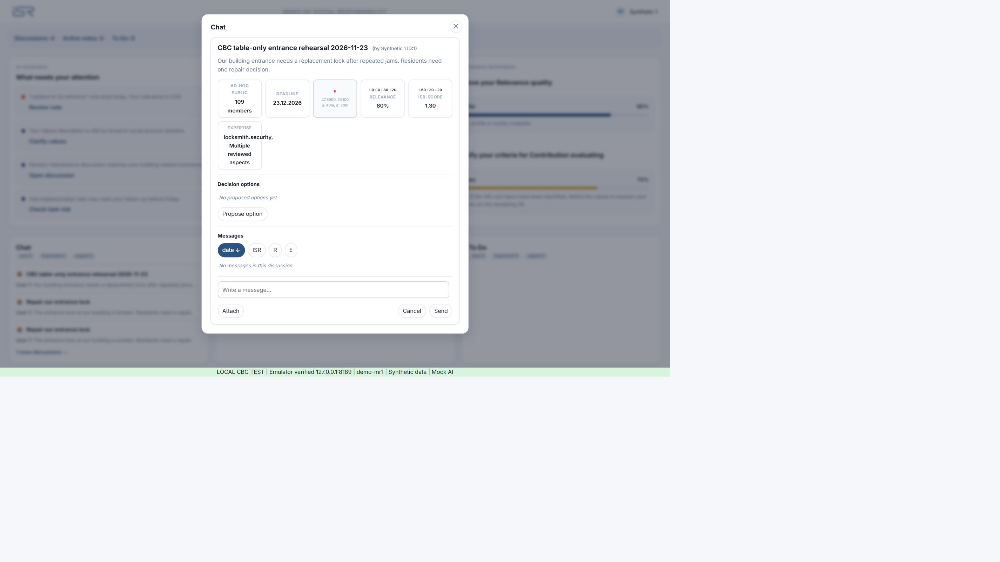

# CBC emulator and browser report (2026-11-23)

Result: passed on main 7027110 plus test-only fixture extensions. Application/scoring/browser product files are unchanged. No production access, data import/export, provider/embedding call, credential loader, rules change or deployment. The existing author emulator/serving checkout is untouched. Temporary demo emulator and preview server were stopped after verification.

## Endpoint and independent arithmetic checks

Disposable demo-mr1 Firestore at 127.0.0.1:8189; hub44890/log45890. Original hub4489 was unavailable; no existing service was stopped. The early attempt failed before database initialization; a fresh emulator was verified before the passing run. Opt-in actual HTTP handlers run against this Firestore with scripted SDK responses and synthetic vectors/profiles.

| Check | Observed result |
|---|---|
| New policy | mr1-cbc-table-1; refs omit CBC adjustment |
| New Check/Create | 109 members (A105/B4), including rejected-X and zero-X relatives |
| Explicit Join, concurrent/repeated | 110 members; idempotent |
| Bachelor education, cosine .6 / CBC1 / power4 | 2.400 |
| Vocational education, cosine .8 / CBC2 / power2 | 1.280 |
| Frozen legacy .9 multiplier, vocational | 1.338 stored; legacy scoring version retained |
| Independent Python current/legacy audit | Both passed, no problems |
| Audit corruption test | Deliberately altered expertise rejected |
| Draft/context/population/unknown-version guards | Refused; completed replay preserved |
| Oversize storage/commit guards | Refused before publication |

One opt-in endpoint test passed in31.1 seconds. Local result log is scratch/cbc-table-only-20261122/emulator-tests.log (C checkout). The log contains expected errors from negative cases, followed by a successful TAP result. No actual Gemini calls were made; an application label naming Gemini is not model-quality evidence.

## Actual browser check

Used local preview http://127.0.0.1:5190/main.html?emulator=1 with synthetic session1 and mock AI; the page's host-check banner explicitly verified 127.0.0.1:8189 / demo-mr1 before writes. Created a uniquely titled disposable CBC regression issue, supplying a separate-issue explanation when the duplicate UI identified the seeded issues.

- Check displayed109 members, Relevance80%, ISR1.30; Create was enabled after the required explanation.
- Creation confirmation reported109 members; the opened saved issue retained109/80%/1.30.
- The members popup opened and displayed the full public, not only the25-member preview; membership included the low/zero-Relevance relatives from the synthetic fixture.
- Rendering was visually checked; no score/count/list-loading regression observed. This verifies the synthetic flow only, not paid Analyzer judgment, full-scale capacity or production readiness.

[Preview screenshot](CBC-emulator-evidence/browser-preview.jpg), [saved issue](CBC-emulator-evidence/browser-created.jpg), [members list](CBC-emulator-evidence/browser-members.jpg).



## Reproduction

First PowerShell terminal, from the feature worktree (no import/export):

```powershell
$env:JAVA_TOOL_OPTIONS="-Xmx1g"
firebase emulators:start --only "firestore" --project demo-mr1 --config functions/test/mr1-emulator.json
```

After the ready message, a separate PowerShell terminal in that worktree:

```powershell
$env:NODE_PATH="C:\isr-mvp\functions\node_modules"
$env:FIRESTORE_EMULATOR_HOST="127.0.0.1:8189"
$env:GCLOUD_PROJECT="demo-mr1"
$env:GEMINI_API_KEY=""
$env:MR1_EMULATOR_TESTS="1"
node --test functions/test/mr1-integration.test.js
```

The test requires an empty disposable database and refuses other endpoints/projects. Do not rerun against populated emulator state; start a new disposable emulator without import. Browser preview is test-only, accepts demo-mr1 or demo-mr1-preview, and is not a production configuration.

## Next increment

[Overall-grounding offline plan](Values-grounding-offline-implementation.md) is prepared for review. No Values code/backfill or X eligibility implementation was performed. CBC verification PR merge and that future implementation approval are separate actions.
