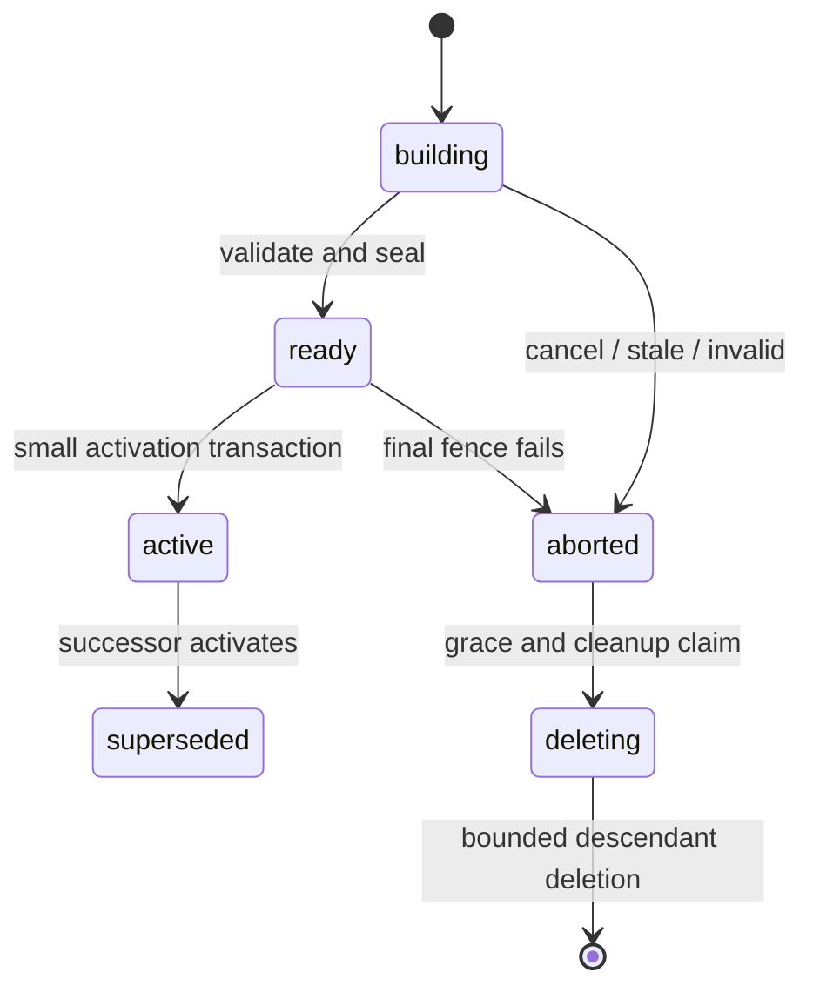

# M3 Phase C: immutable generations and atomic activation

Date: 2026-11-18. Source examined: main **7973380** (#47 plan and #48 audit merged; post-merge Node/Python CI passed). Author: **"Phase C offline design approved"**. This approval authorizes this design and consumer review, not implementation, a new storage schema, database access/import, rules edits, paid requests or deployment. Proposed choices require review before implementation. No files under docs/ are changed.

## 1. Recommendation and review boundary

Build a complete, immutable result privately in byte-bounded chunks, validate it, then publish a small authoritative pointer and bounded topic summaries in one transaction. Readers resolve that exact generation. A Join builds a successor instead of updating thousands of visible member records in place. Historical records keep their existing interpretation; new records explicitly declare a new publication format. This changes **physical atomicity of preparation**, while requiring **logical atomicity of visibility and decisions**.

The [Phase A audit](M3-capacity-audit/README.md) disproves compact-only fit across intended shapes: 9,150 members / 19 distinct calculation slots still require 13,793,088 compact Create bytes against the 10,452,992-byte guard. Nineteen fixtures completed; three large 100-reference fixtures timed out. Those timeouts, real-population memory/performance, index costs and server operation acceptance remain unresolved. A generation design is not evidence that they now pass.

| Proposed choice | Reason / consequence |
|---|---|
| Private build data below issue_drafts, server-mediated published reads | Existing rules exclude this top-level namespace from clients. Staging cannot appear in ordinary member/dashboard queries. Server endpoints must enforce publication themselves. |
| Full immutable member generation per successful Join | Simple serial history and frozen evidence; O(N) preparation/read/write cost per Join remains and must be measured. Immutable context blobs may be shared; no evidence dropped. |
| Small issue root is authoritative; discussion/public roots carry matching mirrors | One activation transaction changes all small roots. Cross-listener clients render only matching generation tags. |
| First prototype uses an explicitly immutable, allowlisted emulator source | Today's open client writes cannot establish a reliable global source revision. Live source enforcement is a later gate. |
| Backend commands for new-format lifecycle mutations | Current browser map-based transactions cannot safely decide from paged private membership. Legacy paths stay separate. |
| Retain published generations and creation replay artifacts initially | Preserves audit/replay/old-view references. Storage grows; later published-history retention needs approval. Cleanup initially concerns never-published terminal builds. |

**Suggested next approval after review: C1, a pure offline protocol prototype** (section 13). This design approval, PR merge, or future C1 approval does not authorize a Firestore adapter, runtime reader, rules or live changes.

## 2. Invariants and non-goals

1. No generation is usable for membership, values, weights, duplicates or tally before activation commits. No staging roots in public issues/discussions/member collections.
2. One decision uses one publication token: issue identity, generation ID, immutable manifest digest and publication epoch. Mutable phase/votes/options have separate revisions. Caller-supplied scores and caches are never authoritative.
3. Preserve mr1 arithmetic, all reviewed references/aspects, raw receipts/provenance, A/B/explicit membership, zero-X B, frozen outgoing A links and exact rounding inputs. No member cap, reference truncation, altered threshold/model or recalibration. Publication and scoring versions are independent.
4. Create is idempotent for the checked draft; Join is idempotent for issue/person and publishes one event. Restart never repeats paid analysis/embeddings.
5. Source freshness, duplicate coverage and ownership must be enforceable, not hashes claimed by an untrusted caller or asynchronous triggers.
6. Completed creation_result responses and historical D1 scores/tally/tasks retain their old meaning. No automatic migration or large legacy shadow dual-write.
7. Arbitrarily large values are not guaranteed to fit. An unsplittable unsupported value refuses safely, never publishes partially.

## 3. Verified consumer inventory

Locations refer to main 7973380. Implementation must repeat the search. This is a source review, not a database census.

| Consumer | Current dependency | Required new-format behavior |
|---|---|---|
| functions/mr1-service.js:24, :86 | Check/Create retain population, model, root maps/full replay; duplicate scan in Create transaction | Private durable build, bounded roots/replay, catalog/source fences. Old completed replay unchanged. |
| functions/mr1-engine.js:29, :60; multi-reference.js:76; isr.js:124 | All profiles retained, batched vectors, canonical cohort/normalization | Paged evidence/scratch preserving exact numeric/input order. |
| functions/join-issue.js:44 | Reads all members, renormalizes every row, updates maps/values/event | Private successor; final CAS on base generation/phase; current Join semantics. |
| functions/similar-issues.js:65, :106 | Active-title uniqueness/top-five suggestions, membership from maps/participants, issue/vector scans | Published active catalog, unchanged matching, selected-generation membership and complete coverage/version fence. |
| functions/close-voting.js:13; deadlines.js:17, :44; index.js:130 | Membership/tally queries, some member reads outside transaction, approved trigger/scheduler | Generation-pinned outcome preparation and bounded final transaction; no staged lifecycle trigger. |
| functions/lifecycle.js:122, :159, :211, :231 | Pool, 30% management/deadline rules, phase snapshots copying maps | Same decisions; adapter supplies authoritative scores and bounded snapshot references. |
| prototype/js/main.js:2255, :2867, :6010, :6157 | Member popover, assignees, member issue lists/previews | Tagged cached pages/lookup, every member reachable, stable full count. |
| main.js:3544, :3565, :4351 | Browser management transaction and option votes use maps | Backend command checks generation/phase/vote revisions and authoritative membership. |
| main.js:3882-4587, :7478, :7827, :7885, :8650, :8719 | Modal/list listeners, sorting, participant membership and caches | Version adapter, consistent listener-driven prefetch; no fallback to old maps/staging. |
| main.js:5661, :5849 | Check/Create expect immediate success | Versioned asynchronous status, durable receipt, paginated frozen replay. Ordinary checking/creating/joining copy. |
| scripts/mr1_check.py:149; check_demo.py; multi_reference.py | Legacy member/maps and independent math | Decode selected sealed mr1 generation; retain legacy D1 audit; incomplete/unknown formats fail. |
| scripts/backup_firestore.py; restore_firestore.py | Existing recursive typed-path backup/restore | Rehearse private hierarchy, source/manifest/context leaves and replay references. No backup run now. |
| firestore.rules; new backend readers/writers | Open prototype writes except drafts/logs; Admin bypasses rules | Separate rules/access/IAM review; synthetic profile adoption is not authentication. |

Inventory every direct mr1_evidence/social_links/relevance_scores/isr_scores/participants and member/public query in helpers, migrations and tests too. Old demo helpers must refuse new format unless adapted, rather than silently writing legacy maps onto its roots.

## 4. Proposed records and visibility

These names are a concrete proposal, **not permission to access/create collections**.

| Proposed location | Contents / authority |
|---|---|
| issue_drafts/{draft_id}/publication_builds/{build_id} | Bounded control: operation key/kind, stable reserved topic/public IDs, Join base token, source/catalog bindings, input/model/code hashes, scoring timestamp/day, lease epoch/expiry, stage/cursors, state and seal. |
| Descendants of that build | Immutable member/evidence/link pages, shared model/aspect/vector/raw-receipt blobs, ordered indexes, replay pages, values and bounded manifest tree. Scratch has a separate prefix and is never a published reader target. |
| issue_drafts/__sources/snapshots/{snapshot_id} | Source manifest/seal and private allowlisted source pages. Authority independent of caller job metadata. |
| issue_drafts/__source_control | Enforced immutable-source ID or future transactional epoch/writer protocol version. |
| issue_drafts/__u10_creation_registry and proposed title/catalog records | Catalog revision, bounded entries/pages and normalized-title ownership; no giant registry map. Every relevant writer participates. |
| Existing issues/{id} | publication_version, active_generation_id, active_manifest_hash, active_build_ref, publication_epoch, public ID, bounded context/member summary, existing phase/options/votes/tasks within guards. Authoritative token. |
| Existing discussions/{id}, microcommunities/{id} | Matching token and bounded summaries/counts/mutable conversation metadata; no full score maps/participant array for this version. |
| Existing issue_vectors/{id}, initial message | Small retrieval vector/metadata and initial message created at activation; aspect vectors/full provenance are private referenced artifacts. Oversized text requires reviewed lossless paging or refusal. |

Directory/replay pages avoid a single 9,150-name dictionary or full response on a draft. Metadata and one member's evidence/links may themselves require pages; a dictionary cannot become the next 1 MiB bottleneck. Decoding reconstructs exact strings, dates, IDs, numeric bits and provenance, without truncation or substituted vectors. Unknown versions refuse. Phase A's restricted codec is an experiment, not the accepted storage schema.

A published source reference must point to retained immutable data, or exact required source data must be included in retained artifacts. A pointer to mutable users/vectors is not frozen evidence.

## 5. States, leases and chunks

These private states are not public lifecycle statuses. Retryable/paused diagnostics never make an incomplete result readable.

- Initial claim stores a server-selected operation key, random build identity, stable reserved IDs and monotonic lease epoch. Renew/transfer in a transaction. Same immutable bindings retain IDs on resume; changed input/base/source makes a new build.
- Proposed chunk target: **512 KiB encoded request and <=100 writes**, whichever comes first. These are conservative application targets, not Firestore operation-limit claims. Keep existing document/request margins. Split by actual SDK bytes; a single oversized leaf must be losslessly segmented or refused.
- Every chunk transaction checks state=building and current owner/lease epoch, creates deterministic immutable leaves and commits its checkpoint/receipt together. Same leaf/hash is a replay no-op; different hash is corruption. No unfenced bulk writes that finish after ownership transfers.
- Manifest leaves bind canonical path/type/hash/count/ordinal ranges. A bounded-fanout tree avoids an unbounded root list of hashes. Trusted validation checks complete expected ranges, duplicates/missing IDs, codecs and exact count/cohort/value/normalization invariants. Counts alone are not proof.
- Seal building->ready only after validation; all writer paths prohibit leaf changes afterward. Checkpoints retain exact finite accumulator bits, ordering state and completed ranges. Recovery verifies hashes instead of trusting a cursor. Invalid/unsealed scratch cannot satisfy a published read.
- Activation/cancellation CAS the same control. If cancellation wins, activation refuses; if activation wins, cancellation cannot delete published data. An expired worker cannot use an old epoch, write after seal or activate stale work.

## 6. Bounded scoring without new mathematics

A quantum has input-byte and row ceilings (initial candidates: <=4 MiB decoded inputs and <=75 profiles), releases vectors/evidence after durable pages and checkpoints before its time budget. Targets require measurement; oversized profiles need segmentation/refusal. One worker per operation; no hidden parallel memory multiplication or increased 512 MiB application limit. Offline resource tests retain 256 MiB heap, 512 MiB RSS, 120-second child and >=1 GiB free gates. Whole-build byte/chunk/work/deadline quotas are mandatory and bound repeated quanta separately. C1 tests explicit budget exhaustion; C2 numerical defaults must come from measured source/output envelopes. An unconfigured/unbounded quota refuses a build, rather than allowing indefinite staging.

1. Page sealed source in current lexicographic document-ID order. Validate required vectors/skills/relations with the current engine, evaluate direct components/expertise and write evidence/scratch/eligible links. Do not skip malformed sources. Retain the current population digest over ordered typed user/vector inputs and day; separately bind values and the source manifest.
2. Discover all A using the current threshold. Traverse A and target keys in the current JS enumeration order. Include B with zero X or rejected full addition; preserve eligible-best addition, source ceiling/epsilon, lexical source tie break, first-encounter B order and outgoing A links. No second hop.
3. Normalize exactly the stored rounded R/E used today. Preserve equal/zero shortcuts and sequential IEEE-754 addition order; no sums-of-page-sums. Checkpoint finite accumulators/first-value/all-equal/count/order exactly, then apply the same division, Engine.round locations, constant C and ISR aggregation.
4. Aggregate values in the same member/getAll order, with current missing-value defaults and first-nonempty item-length rule in public-values.js. Preserve each dimension's addition order; encoding/page boundaries cannot change arithmetic.

Orders differ: Create A-then-B encounter order; Join existing member document-ID order then new UID; JS map keys for Lifecycle.pool and vote tally; values input order. Store corresponding ordinal/digest metadata explicitly; do not replace these with numeric UID sorting. Require exact Node oracle equality. Python's existing cross-language tolerance is additional evidence, not permission to change Node results.

Check freezes its scoring timestamp/day and reviewed input. Create reserves its registration timestamp before scoring, on the same checked UTC day, matching current Create/Join age-date semantics. Resume keeps that timestamp; published created_at uses it, with publication time separate. A job crossing midnight needs Check again before initial activation; completed replay does not. Same-day input/population/location/contract checks remain. Paid receipts/aspect vectors are reused only for identical bindings; capacity recovery never calls the provider or invents a missing vector.

## 7. Source freshness and duplicate coverage

**First emulator prototype:** a new isolated allowlisted sealed source with enforced no-write policy and authoritative source ID. This proves only fixed-source behavior. No import is authorized here; the old full-import method's 6 GiB free prerequisite remains.

**Future dynamic source:** every profile/vector/value/relationship create/update/delete and source-set membership change updates the epoch in the **same transaction** as that change. Browser/server/import/migration/admin writers must form an enforced closed set. An asynchronous after-write trigger has a race and is insufficient. Copy source pages between identical start/end epochs, check counts/digest and seal the copy with that epoch. Final activation rereads authority; changed epoch/source ID refuses. Any bypassing writer keeps this mode disabled. Binding values as well as scoring inputs is an explicit proposed freshness strengthening, not a silent change to today's Check hash.

Join retains existing members' frozen R/E, names and links. Capture a fresh sealed input for the joining profile/vectors and values of **all** resulting members (current Join refreshes values). Evaluate the new member with original registration date/frozen A links, and recheck its source fence at activation. Never rescore the original public onto the new source implicitly.

Duplicate review moves outside the small activation transaction: prepare a complete **published active** issue/vector catalog snapshot under a revision fence. Apply unchanged Similar matching, top-five/reason/version review, active-only title uniqueness, and generation-scoped already-member checks. Exclude staging.

Every relevant creation/title/context/location/vector/phase/deadline/archive/delete mutation, including legacy writers, must advance catalog authority atomically. Bind Europe/Zurich active-day and UTC scoring day: time can change active status without a write. Activation rereads registry, date and title ownership. New revision/stale reviewed match returns review/recheck conflict; never quietly ignores a new duplicate. Title keys use Similar.titleKey; hash collisions compare full normalized keys and fail closed. Claim/release titles and update entries in activation/phase transactions. Include legacy active titles before enablement. Today's open direct writers do not satisfy this protocol.

## 8. Small activation transaction and frozen replay

Proposed transaction inventory (private intent names remain provisional):

| Operation | Reads | Writes |
|---|---|---|
| Initial Create | Draft/intent, ready build, source control, source seal, catalog registry, title claim (six controls); target roots use create-if-absent preconditions | Issue, discussion, public, issue vector, initial message, draft completion receipt, build state, title claim, catalog entry, registry revision (ten) |
| Join | Issue, discussion, public, Join intent, ready build, source control/seal, catalog registry, per-issue membership-builder control (nine) | Three root mirrors, Join intent completion, build state, membership-builder release, event, catalog entry, registry revision (nine) |

Additional authorization/version controls must be counted explicitly; never conceal population-sized reads. Generation changes advance the catalog revision where catalog entries carry membership pointers. This conservative global contention is acceptable only if measured for the prototype; no high-throughput claim.

Read bounded controls only: draft/intent, ready build/lease/seal, source control/seal, catalog registry/title claim, and relevant topic/public roots for Join. Target <=16 reads and <=16 writes; actual inventory/bytes must be measured. Counts are independent of population. No profile/member/catalog scan, manifest traversal, scoring or paid call occurs inside activation.

Recheck operation/caller/input/model/contract/code bindings, scoring day, source/catalog freshness, lease, readiness/idempotency and base publication/phase revisions. Then atomically:

- create small issue/discussion/public/vector/message roots for Create, or update matching publication/count/values references for Join;
- switch authoritative token and mirrors, increment publication epoch;
- record bounded completed draft/Join receipt and exactly one Join event;
- update title/catalog claims and build state. Join uses narrow masks and current controls, never staged conversation/options/deadline/phase fields.

A trusted validator's sealed immutable data underpins the small receipt; client-provided hashes/counts do not authorize publication. Source/phase conflict aborts or rebases the private build with no partial roots.

New Create has an **explicit versioned async response**: pending status/operation receipt, then stable IDs/count and immutable result-page reference/digest. Retain the **complete original logical members response** in pages, in frozen order/names/scores; no hidden 25/100-member truncation. Replay returns the same initial receipt/pages after Join/closure without recomputation. Old completed drafts return their exact old response body. Browser/API version tests must ensure pending is not success; incompatible clients receive a clear refresh requirement rather than silently reading incomplete data.

## 9. Readers, dashboard and cache

Resolve the issue's authoritative token, then read only that immutable generation. Published-read endpoints must verify that a requested artifact was actually published for that issue; a private path/build ID is not a capability. An explicitly pinned old view/replay may use a published old generation with its historical counts, never label it current.

All pages/cursors bind issue/generation/manifest/epoch and sort. UID lookup selects one generation-scoped row; directory/rank pages expose every member over pagination. Missing pages/hash mismatch are errors, not empty publics. A root without valid publication metadata cannot become a new-format visible topic.

Dashboard listener pathways prefetch viewer scores/first pages through the adapter. Commit matched cache bundles only when root/header/member tags agree; discard late requests. Keep the previous complete view, or show loading, until ready. No new count with old scores, hidden DOM writes outside cache sync, or direct database click-fetches when data should be cached. Retain v8 Compat APIs.

Participant/flat-member queries cannot discover private generations. New discovery pages the **published catalog**, checks generation membership and merges legacy results by issue ID. Per-user advisory indexes may accelerate this; they are not authoritative. Staged entries must match the chosen active token, and an incomplete index cannot claim complete coverage. Show continuation/coverage instead of silently shortening lists.

## 10. Join, phases, voting and tally

At most one membership builder per issue. Same issue/UID requests coalesce; existing published membership returns already_member with no event. Another UID receives retryable busy/rebase status, not silent intent loss. Successful CAS order defines the serial Join history, with full renormalization/successor data. No new 100-member cap.

| Race | Required outcome |
|---|---|
| Different Joins built from g0 | One publishes g1. The other rebases against g1 with fresh input; never overwrites its changes. |
| Same UID, transport loss/restart | Exactly one membership/event; check durable receipt before retrying. |
| Start Voting/deadline versus pending Join | Both read the same control. If phase change wins, Join cannot activate outside chat. If Join wins, transition retries with new weights. Building does not lock the topic for minutes. |
| Options/messages edited during Join | Narrow masks preserve edits; option-dependent transitions check their own revision. |
| Cancel/archive versus activation | Expected phase/status revisions prevent resurrection. |
| Back to chat | Preserve current vote-clearing rule; later Join uses then-active generation. Never change recorded voting/tally history retroactively. |

New-format management/vote/option/task writes become backend commands checking expected token and relevant revisions, authoritative membership/weights and unchanged Lifecycle/ISR decisions. Client previews are advisory. Support IDs remain choices by people, not caller-supplied weights; current generation weights apply after Join as current root-map updates do. Join itself does not invent automatic management execution.

Entering voting freezes the selected generation for that round; Join stays chat-only. Any outcome prepared outside a transaction binds generation, phase, vote and option revisions; change invalidates it. Stage large tally/evidence/task results privately, then atomically publish the phase change with complete outcome reference/summary. To Do must not appear with half-written winner/tasks. Preserve thresholds, exclusions, ties/extensions and task ownership. The approved trigger recognizes an already-complete new-format receipt; legacy trigger behavior remains separate.

ISR.tally/Lifecycle.pool preserve JS enumeration and sequential summation, using frozen membership rather than partial pages/root caches. Counted/excluded evidence can be paged. Votes/options/tasks/lifecycle arrays remain **other bounded documents**: this design does not prove arbitrary growth fits. Require worst-supported-shape tests and guard/refusal or a separately reviewed lossless paging format; never discard votes/options/tasks to fit.

## 11. Access, recovery and cleanup

A cached old browser directly queries these collections and can ignore new version fields. A refresh message on an HTTP endpoint alone cannot make that browser safe. Keep the format disabled live until an explicit client cutover/direct-read policy prevents old readers from treating pointer-based roots as legacy maps. This may require a reviewed maintenance/version gate and new server-mediated catalog reads; no seamless mixed-client rollout is claimed. New implementation must demonstrate a failing-safe stale-client scenario. Do not reintroduce unbounded legacy shadows to conceal the issue.

Current rules allow most prototype access. Public staging flags do not provide isolation. Private placement uses the existing issue_drafts exclusion, but Admin bypasses rules; backend paths must enforce owner/fence/state/publication themselves. Synthetic profile adoption via sessionStorage is not authentication; no confidentiality or strong authorization claim follows.

Before live enablement, review rules/authorization/IAM to protect new root pointer/count/phase writes and enforce source/catalog writer participation. A narrower deny does not override a catch-all allow. Queries must meet authorization conditions; rules are not result filters. Keep live generation mode disabled until relevant direct/legacy writers are covered. No rule is edited and no access redesign/deploy is authorized here.

Rehearse existing recursive typed backup/restore on a private multi-page generation, source/manifest/context/replay references and an independent score/tally audit in a fresh disposable emulator. Do not overwrite accepted exports/journals/frozen reports. This task runs no backup/restore.

Initially retain active/superseded published generations, voting/tally references and completed creation replay. Do not roll back an active pointer automatically after decisions use it. Feature rollback may stop new builds but must keep a compatible reader/backend for published topics; old map readers cannot serve them safely.

For **never-published** aborted/invalid builds, propose seven days' recovery grace, then a transactional deletion claim checking terminal state/no activation/lease epoch. Activation and deletion conflict on the same control. Delete descendants in byte/work-bounded resumable batches and verify completion before a bounded tombstone. Do not assume parent deletion removes descendants. Cleanup cannot affect shared/active/replay history or become an unbounded sweep. Cleanup implementation/retention enablement needs later approval/tests.

## 12. Acceptance matrix

No row is claimed implemented by this document.

| Area | Required evidence |
|---|---|
| State/CAS | Crash before/after checkpoints/seal/activation; stale lease; competing builders/cancel; once-only completion/event; fixed bounded final transaction. |
| Bytes/resources | 100/1,000/9,150 plus 9,151st Join; 1/3/19/100 refs, 1-3 aspects, shared/distinct slots, dense links/long receipts; every leaf/chunk/root measured with masks/transforms/index concerns; quantum and whole-operation work/time/refusal limits. Old timeouts are not passes. |
| Numbers/provenance | Exact Node cohort/order/values/normalization/replay parity across pages/restarts; independent Python check; no missing zero-X B, source/tie/field/raw receipt/vector; corruption/unknown versions refuse. |
| Source/catalog | All source changes/deletes/set membership; bypass writer; day rollover/title collision/new similar issue between scan/activation; no stale/unknown-coverage publish. |
| Readers/lifecycle | Listener reordering, stale pages/cursors/missing page, member/rank/assignee/other-profile lists; pinned management/vote/deadline/tally/task races; staging never triggers actions; legacy regressions. |
| Access/recovery | Client staging read/list/write and unpublished server read refused; root tampering refused under reviewed rules/backend; restored hashes/scores/tally match; cleanup cannot delete reachable data. |

## 13. Proposed sequence and next decision

| Step | Scope | Approval/exit |
|---|---|---|
| **C1: pure offline protocol prototype (recommended next)** | Fake store/modules: states/lease epochs, byte-bounded immutable manifest/replay pages, activation CAS, cancel/cleanup, source/catalog tokens and race traces. Tiny synthetic input; no Firestore/model client, browser, import/rules/data writes. No application scoring port or whole-population performance claim. | Separate author approval of this design and limited C1 scope; deterministic protocol/corruption/race tests and measured byte/operation inventory. |
| C2: isolated emulator adapter and reader/lifecycle slice | Default-off new version, tiny sealed allowlisted source, real handler/serializer chunks, published reads/cached UI/server commands. Legacy unchanged. | Separate spec/approval. Small endpoint/access-policy tests and human UI check; no paid calls or accepted large-export import. |
| C3: resource-gated population parity | Stream accepted immutable source to a new disposable environment only after measured restore prerequisites. Cached review and **actual matching** aspect vectors required. | Separate resource/import approval; full numeric/membership/cache/replay/Join/races/recovery under application limits. Missing vectors need their own embedding/paid gate. |
| Later live readiness | Enforced source/catalog writers, access/rules/IAM, all consumers, recovery and author runbook. | Separate architecture/security/policy decisions; author-only deploy/live apply and human review. C1-C3 grant no live permission. |

No model comparison is needed. Sol Medium is sufficient for C1; keep the application model/config. Raise ambiguities in approved scoring/lifecycle rules rather than changing them as storage work.

## Status and verification

- 2026-11-18: Author approved Phase C **offline design**. Feature branch codex/m3-generation-design starts at main 7973380. Reviewed the complete Phase A plan/result and producer/consumer source. No paid call, credential loader, source export decoding, database RPC/write/import, browser/runtime/code/rules/docs/ edit or deploy.
- Choices and C1 scope are proposals, not runtime/schema acceptance. Final documentation/link/source and required Node/Python checks/CI are recorded before handoff. Merge remains author-only.

## Official constraints checked 2026-11-18

[Firestore quotas](https://firebase.google.com/docs/firestore/quotas) and [transactions](https://firebase.google.com/docs/firestore/manage-data/transactions) establish document/request/time constraints; protobuf bytes do not prove index/server acceptance. [Secure querying](https://firebase.google.com/docs/firestore/security/rules-query) and [rule conditions](https://firebase.google.com/docs/firestore/security/rules-conditions) describe server rule bypass and query authorization. These motivate this proposal; they do not validate an unimplemented protocol.
